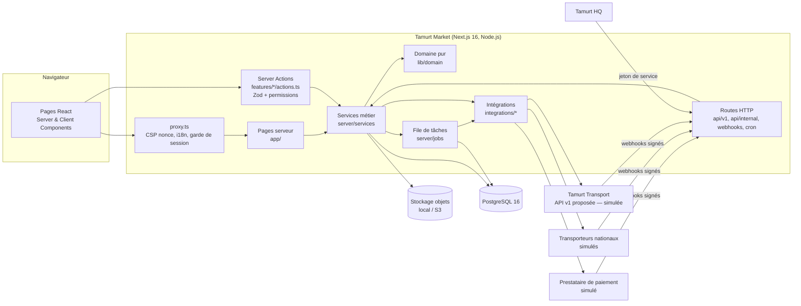
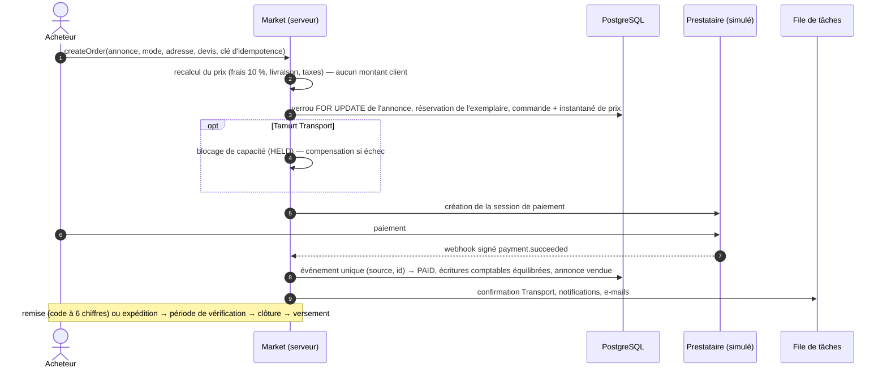
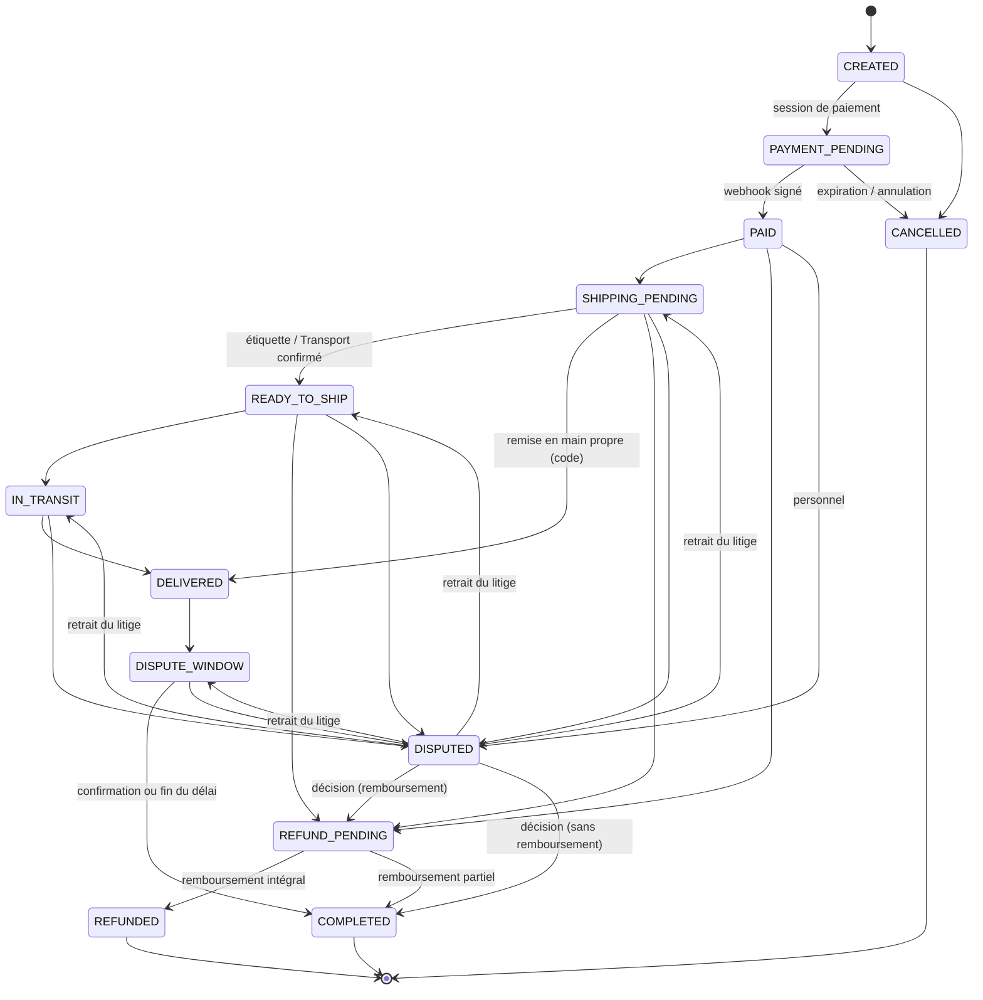

# Architecture

Tamurt Market est un **monolithe modulaire** Next.js (App Router) : une seule application déployable, découpée en modules à responsabilités nettes. Ce choix (voir [DECISIONS](DECISIONS.md), ADR-001) privilégie la simplicité d'exploitation pour une petite équipe, tout en gardant des frontières qui permettraient d'extraire un service plus tard (paiements, recherche).

## Vue d'ensemble

## Couches

| Couche | Emplacement | Règles |
| --- | --- | --- |
| Domaine pur | `src/lib/domain` | Aucune E/S. Argent en entiers, calcul des frais, machines à états (commande, annonce), conformité, permissions, détection de risques. 100 % testé unitairement. |
| Services | `src/server/services` | Logique applicative et transactions. Vérifient **toujours** l'appartenance des objets (anti-IDOR) et les permissions. Importent `server-only`. |
| Actions serveur | `src/features/*/actions.ts` | Point d'entrée des formulaires : validation Zod (les clés inconnues, dont tout montant, sont supprimées), session, appel de service, `revalidatePath`. Enveloppe commune `action()` : aucune erreur interne exposée. |
| Routes HTTP | `src/app/api` | API publique v1 (lecture), API Tamurt HQ, webhooks signés, tâches planifiées (`CRON_SECRET`), fichiers privés. |
| Pages | `src/app/[locale]` | Composants serveur par défaut ; composants client limités à l'interactivité. |
| Intégrations | `src/integrations` | Adaptateurs derrière des interfaces : `PaymentProvider`, `ShippingProviderAdapter`, client Tamurt Transport. Les simulateurs implémentent les mêmes interfaces. |
| Infrastructure | `src/server/{db,jobs,storage,email,security,auth}` | Prisma (adaptateur `pg`), file de tâches, stockage, e-mails, limitation de débit, signatures, authentification. |

## Modules fonctionnels

`features/` : `auth`, `profile`, `account`, `listings`, `search`, `favorites`, `messaging`, `reports`, `orders` (commande, livraison, litiges, avis), `transport`, `admin`, `dev` (outils de simulation, désactivés en production).

## Flux principal : achat

## Machines à états

Commande (`src/lib/domain/order-state.ts`) — chaque transition est vérifiée (acteur autorisé), appliquée avec verrou optimiste (`status` + `version`) et historisée en ajout seul.

Annonce (`src/lib/domain/listing-state.ts`) : `DRAFT → PENDING_REVIEW | ACTIVE → RESERVED → SOLD`, avec `SUSPENDED`, `REJECTED`, `ARCHIVED`, `DELETED` ; les transitions de modération sont réservées au personnel habilité.

## Tâches asynchrones

Modèle « outbox » dans PostgreSQL (table `job`) : les tâches sont créées **dans la même transaction** que l'état métier qui les déclenche. Exécution par `after()` après la réponse HTTP, par la route `/api/cron/jobs` et par `pnpm jobs:run` ; verrouillage `FOR UPDATE SKIP LOCKED`, reprise avec délai exponentiel, état `FAILED` = file des échecs consultable en administration. Types : `email.send`, `notification.email`, `refund.execute`, `payout.release`, `transport.reservation.confirm`, `transport.reservation.cancel`, `images.cleanup`.

La maintenance (`/api/cron/maintenance`) expire les commandes non payées, clôture les périodes de vérification, compense les blocages Transport expirés, rejoue les webhooks en échec, relance les versements bloqués, purge sessions, jetons et données d'audience au-delà de leur durée de conservation.

## Internationalisation

`next-intl` avec segment `[locale]` et préfixe « au besoin » : le français (langue par défaut) n'a pas de préfixe. Seul `fr` est actif ; `ar` (sens d'écriture droite-à-gauche prévu dans la mise en page), `kab` et `en` sont préparés dans le routage. Les messages sont typés ; montants et dates passent par `Intl`.

## Rendu, cache et performances

- La CSP à nonce impose un rendu dynamique des pages ; les données de référence (catégories, réglages, conformité) sont mises en cache en mémoire avec invalidation explicite.
- Images : WebP redimensionnées (miniature et grande taille), placeholder flou, cache HTTP public pour les annonces publiques uniquement.
- Requêtes de recherche en SQL paramétré sur index GIN ; pagination bornée (50 pages).

## Sécurité transversale

Voir [SECURITY](SECURITY.md) : CSP stricte à nonce, en-têtes de sécurité, sessions avec cookies `HttpOnly`, double authentification obligatoire pour l'administration en production, permissions fines par rôle, journal d'audit en ajout seul, limitation de débit en base, signatures HMAC des webhooks.
