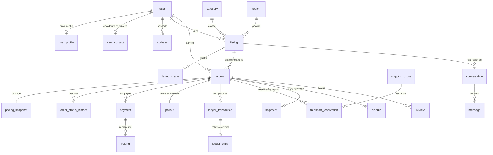

# Base de données

PostgreSQL 16, accès via Prisma 7 (générateur `prisma-client`, adaptateur `pg`). 65 tables, schéma dans [`prisma/schema.prisma`](../prisma/schema.prisma), migrations SQL versionnées dans [`prisma/migrations`](../prisma/migrations). Identifiants UUID v7 (ordonnés dans le temps) ; identifiants publics courts et non devinables pour les annonces (`publicId`) et références lisibles pour les commandes (`TM-XXXX-XXXX`).

## Principes

- **Argent en entiers** : tous les montants sont en unités minimales (centimes d'euro, centimes de dinar) dans des colonnes `Int`, avec une devise ISO à 3 lettres. Aucun flottant, aucune conversion de devise implicite.
- **Intégrité en base**, pas seulement dans le code : contraintes `CHECK`, index uniques partiels, déclencheurs.
- **Ajout seul** pour ce qui fait foi : historique des statuts de commande, registre comptable, journal d'audit, décisions de modération (déclencheur `tm_forbid_mutation` qui refuse `UPDATE` et `DELETE`).
- **Données personnelles séparées** : profil public (`user_profile`) et coordonnées privées (`user_contact`, `address`) dans des tables distinctes ; aucune requête publique ne lit les secondes.
- Les numéros de carte et les copies de pièces d'identité ne sont **jamais** stockés (seuls des identifiants de prestataire et des statuts de vérification).

## Domaines et tables

| Domaine | Tables |
| --- | --- |
| Comptes | `user`, `session`, `account`, `verification`, `two_factor`, `rate_limit` (Better Auth), `user_profile`, `user_contact`, `user_role`, `user_verification`, `business_profile`, `address`, `user_block` |
| Référentiels | `country`, `region`, `city` (variantes de noms pour la recherche), `category`, `category_attribute`, `brand` |
| Annonces | `listing`, `listing_image`, `listing_revision`, `favorite`, `saved_search` |
| Conformité | `compliance_rule` (matrice), `compliance_record` (preuves de validation) |
| Commerce | `orders`, `order_item`, `order_status_history`, `pricing_snapshot`, `fee_rule` |
| Paiements | `payment`, `refund`, `payout_account`, `payout`, `ledger_transaction`, `ledger_entry`, `webhook_event`, `idempotency_record` |
| Livraison | `shipping_provider`, `shipping_quote`, `shipment`, `shipment_event`, `transport_reservation`, `integration_event`, `integration_health` |
| Échanges | `conversation`, `message`, `message_attachment`, `notification`, `notification_preference`, `email_message` |
| Confiance | `review`, `report`, `dispute`, `dispute_evidence`, `dispute_message`, `moderation_action`, `audit_log` |
| Plateforme | `feature_flag`, `platform_setting`, `service_api_client`, `job`, `analytics_event`, `rate_limit_bucket` |

## Modèle simplifié (cœur commercial)

## Contraintes notables

| Contrainte | Garantie |
| --- | --- |
| `orders_total_consistent`, `pricing_total_consistent` | total = articles + frais + livraison + taxes |
| `pricing_seller_net_consistent`, `orders_seller_net_bounded` | net vendeur = articles − commission vendeur, jamais supérieur au prix |
| `pricing_rates_bounded`, `fee_rule_rate_bounded` | taux de frais entre 0 et 50 % |
| `listing_quantity_available_valid` | stock disponible entre 0 et la quantité |
| `payment_amounts` | montant remboursé ≤ montant payé |
| `payment_one_success_per_order` (index partiel) | un seul paiement effectif par commande (les doublons sont marqués et remboursés) |
| `dispute_one_open_per_order` | un seul litige ouvert par commande |
| `transport_reservation_one_active_per_order` | une seule réservation Transport active par commande |
| `fee_rule_one_open_version` (`NULLS NOT DISTINCT`) | une seule version de frais en vigueur par périmètre |
| `compliance_rule_unique_combination` | une règle par combinaison pays × pays × catégorie × prestataire × transporteur |
| `ledger_entry_balanced` (déclencheur de contrainte **différé**) | chaque transaction comptable est équilibrée au `COMMIT` |
| `ledger_transaction_not_empty` | aucune transaction comptable sans écritures |
| `webhook_event (source, eventId)` unique | un webhook n'est traité qu'une fois |
| `orders.idempotencyKey` unique | une requête de commande rejouée ne crée pas de doublon |
| `user_profile_handle_format`, `*_distinct_parties`, `review_rating_range`… | formats et cohérences de base |

## Recherche plein texte

- Fonction `tm_unaccent` (IMMUTABLE) pour indexer sans accents.
- Colonne `listing.searchVector` (`tsvector`) maintenue par le déclencheur `tm_listing_search_vector` : titre (poids A, configurations `french` et `simple`), marque (B), catégorie (C), description (D), ville et ses variantes (« bgayet », « tizi wezzu »…), localité et région (D).
- Index GIN sur le vecteur et sur les attributs JSONB ; index trigrammes (`pg_trgm`) pour la tolérance aux fautes.
- Requête : chaque mot est cherché sous sa forme racinisée OU exacte, les mots sont combinés en ET, repli par similarité de mots sur le titre ; classement `ts_rank_cd` + similarité.

## Migrations

| Migration | Contenu |
| --- | --- |
| `20261107000000_extensions` | `unaccent`, `pg_trgm`, `citext` |
| `20261107134946_init` | Schéma complet + SQL manuel (contraintes, index partiels, déclencheurs, recherche) |
| `20261107160000_handover_salt` | Sel du code de remise en main propre (code dérivé, jamais stocké en clair) |
| `20261107170000_payment_duplicates` | Paiements en double marqués et exclus de l'unicité |
| `20261107180000_search_location` | Ville et région dans le vecteur de recherche |

Règles : `pnpm db:migrate --create-only` puis relecture du SQL avant `pnpm db:deploy` ; jamais de modification d'une migration appliquée. `pnpm db:drift` (exécuté en CI) vérifie que la base migrée correspond au schéma Prisma ; quatre index écrits à la main, non représentables dans Prisma, sont attendus et ignorés.

## Données de référence et démonstration

- `pnpm db:seed` : référentiels idempotents (France : 101 départements ; Algérie : 58 wilayas ; villes principales avec variantes kabyles/latinisées ; arbre de catégories et attributs ; marques ; indicateurs ; réglages ; règle de frais initiale de 10 % ; transporteurs ; matrice de conformité).
- `SEED_DEMO=true pnpm db:seed` : jeu **entièrement fictif** (comptes `@demo.tamurt.local`, annonces marquées `isDemo` avec un bandeau « Démo », images générées). Refusé en production sauf dérogation explicite.

## Conservation

Purges automatiques (maintenance) : sessions et jetons expirés, seaux de limitation de débit, enregistrements d'idempotence, événements d'audience au-delà de 13 mois (réglage `privacy.analyticsRetentionDays`). Les durées légales applicables aux commandes, paiements et litiges sont à valider (voir [COMPLIANCE](COMPLIANCE.md)). La suppression d'un compte anonymise le profil et supprime coordonnées, adresses, sessions et préférences ; les données de transaction sont conservées pour les obligations légales.

## Sauvegardes

Non mises en place (aucun environnement de production). Recommandation : sauvegardes managées quotidiennes avec restauration à un instant donné (PITR), rétention 14 à 30 jours, test de restauration trimestriel, stockage des sauvegardes dans l'UE (voir [DEPLOYMENT](DEPLOYMENT.md)).
