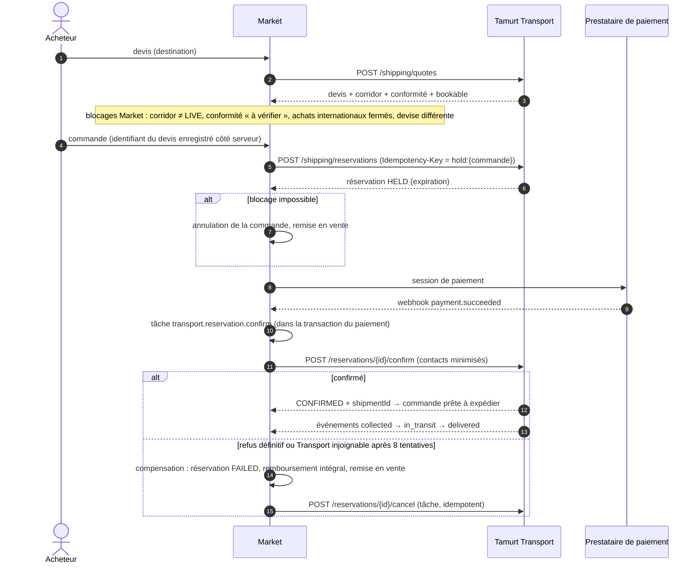

# Intégration Tamurt Transport

## Constat de l'audit

Le dépôt de Tamurt Transport (« Tamurt Sending », envoi collaboratif France ⇄ Algérie par des voyageurs) **n'expose aucune API partenaire** : ni authentification de service, ni devis, ni réservation, ni webhooks. Son corridor France ⇄ Algérie y est en statut de test. Tamurt Market ne peut donc pas s'y connecter aujourd'hui.

En conséquence, Tamurt Market :

1. **propose** un contrat d'API v1 (schémas Zod dans [`src/integrations/tamurt-transport/contract.ts`](../src/integrations/tamurt-transport/contract.ts), spécification générée [`openapi/tamurt-transport-partner-v1.json`](openapi/tamurt-transport-partner-v1.json)) à implémenter côté Transport ;
2. fournit un **simulateur** conforme à ce contrat (`TRANSPORT_INTEGRATION=simulator`), y compris le corridor « test uniquement », les pannes et les événements de livraison ;
3. reste **entièrement utilisable** si Transport est désactivé (`disabled`) ou indisponible : remise en main propre et livraison nationale ne dépendent pas de Transport.

Aucune modification n'a été faite dans le dépôt de Tamurt Transport.

## Principes de couplage faible

- **Aucune base partagée**, aucune table commune : chaque système garde ses identifiants (`partnerOrderId` côté Market, `reservationId` et `shipmentId` côté Transport).
- **Échanges asynchrones par événements** pour le suivi ; appels synchrones limités au devis, au blocage, à la confirmation et à l'annulation.
- **Idempotence obligatoire** sur toute écriture (`Idempotency-Key`) ; mêmes clés lors des reprises.
- **Version** dans l'URL (`/v1`) et révision du contrat dans l'en-tête `Tamurt-Api-Version` (`2026-11-01`).
- **Minimisation** : Market ne transmet nom d'affichage, téléphone et ville du destinataire qu'à la **confirmation** (après paiement), jamais au devis.
- **Pas de double commission** : le prix Transport (commission Transport incluse, selon son propre contrat) est ajouté comme frais de livraison ; les frais de protection Market (10 %) portent uniquement sur le prix de l'article. Vérifié par test d'intégration.

## Contrat v1 (résumé)

| Opération | Méthode et chemin | Portée OAuth |
| --- | --- | --- |
| Jeton de service (client credentials, ≤ 1 h) | `POST /oauth/token` | — |
| État | `GET /health` | — |
| Devis | `POST /shipping/quotes` | `shipping:quote` |
| Blocage de capacité (avant paiement, 5 à 60 min) | `POST /shipping/reservations` | `shipping:reserve` |
| Confirmation (après paiement) | `POST /shipping/reservations/{id}/confirm` | `shipping:reserve` |
| Annulation (compensation) | `POST /shipping/reservations/{id}/cancel` | `shipping:reserve` |
| Suivi | `GET /shipping/shipments/{id}` | `shipping:track` |
| Incident | `POST /shipping/shipments/{id}/incidents` | `shipping:track` |

Un devis indique le corridor et son statut (`LIVE`, `TEST_ONLY`, `DISABLED`), le trajet (date, mode, villes, voyageur vérifié, note), le délai estimé, l'évaluation de conformité de Transport pour la marchandise (`ALLOWED`, `CONDITIONAL`, `TO_VERIFY`, `PROHIBITED`) et un booléen `bookable`. Erreurs normalisées : `quote_expired`, `capacity_unavailable`, `corridor_closed`, `item_not_allowed`, `rate_limited`, `unavailable`… avec indicateur `retryable`.

### Événements Transport → Market

`POST {Market}/api/webhooks/transport`, signés HMAC-SHA256 (`tamurt-signature: t=…,v1=…`), identifiant unique par événement :

`transport.quote.created`, `transport.reservation.created|confirmed|cancelled|expired`, `transport.shipment.collected|in_transit|customs_hold|out_for_delivery|delivered|issue_reported`.

Market enregistre chaque événement une seule fois, met à jour le statut de l'expédition (remis au voyageur, en transit, contrôle douanier, en livraison, livré, incident) et applique les transitions de commande associées (en transit, livrée → période de vérification), puis répond 2xx ; un événement en échec reste rejouable.

## Saga de commande avec Transport

Résilience du client ([`client.ts`](../src/integrations/tamurt-transport/client.ts)) : jeton mis en cache jusqu'à expiration, délai maximal par appel (`TRANSPORT_TIMEOUT_MS`), reprises avec délai croissant pour les lectures et les écritures idempotentes, **disjoncteur** (3 échecs consécutifs → pause de 30 s), journal de chaque échange (`integration_event`) et état de santé (`integration_health`) visibles en administration. Les blocages expirés sans confirmation sont compensés par la maintenance.

## Matrice de dépendances Market ↔ Transport

| Besoin | Responsable | État |
| --- | --- | --- |
| Implémenter l'API v1 (ou une variante négociée) | Transport | **À faire** |
| Comptes de service OAuth et portées | Transport | À faire |
| Émettre les webhooks signés vers Market | Transport | À faire |
| Secret de signature partagé, rotation | Transport + Market | À faire |
| Ouverture du corridor (statut `LIVE`) | Transport | Corridor en test |
| Conformité douanière, transport de marchandises par des particuliers, assurance | Transport + Market + professionnels | **À valider** (voir [COMPLIANCE](COMPLIANCE.md)) |
| Client, simulateur, saga, compensation, interface | Market | Fait |
| Matrice de conformité Market FR→DZ / DZ→FR | Market | En place, statut « à vérifier » (bloquant) |
| Devises : prix Transport dans la devise de l'article | Transport + Market | À convenir (aucune conversion par Market) |
| Contrat commercial (rémunération, responsabilités, litiges) | Direction | À établir |

## Passage en réel

1. Transport implémente le contrat (le simulateur sert de référence de comportement) et fournit une URL de préproduction.
2. Configuration Market : `TRANSPORT_INTEGRATION=remote`, `TRANSPORT_API_BASE_URL`, `TRANSPORT_CLIENT_ID`, `TRANSPORT_CLIENT_SECRET`, `TRANSPORT_WEBHOOK_SECRET` (gestionnaire de secrets, jamais dans le dépôt).
3. Tests de contrat en préproduction (devis, blocage, confirmation, annulation, événements, rejeu, panne).
4. Validation juridique du corridor enregistrée au registre de conformité, puis ouverture par un super-administrateur (indicateur `checkout.crossBorder`, confirmation explicite).
